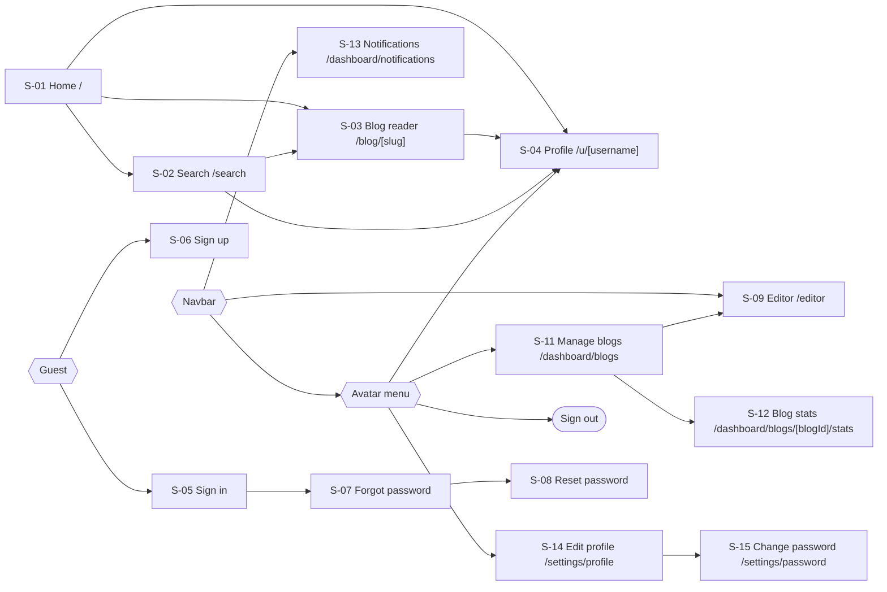
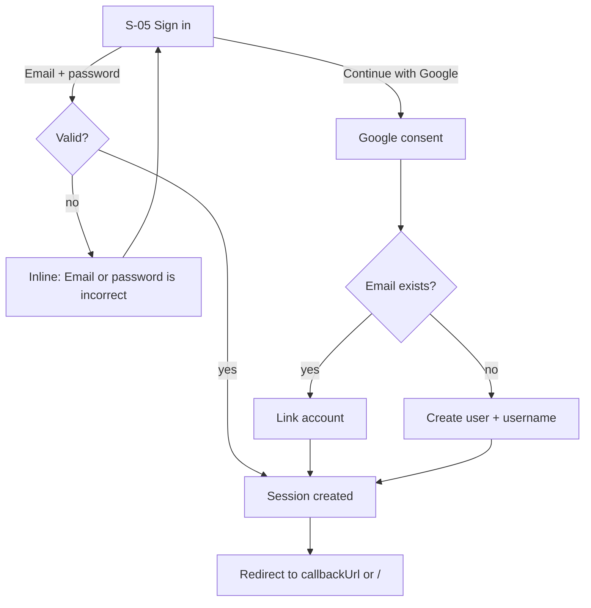
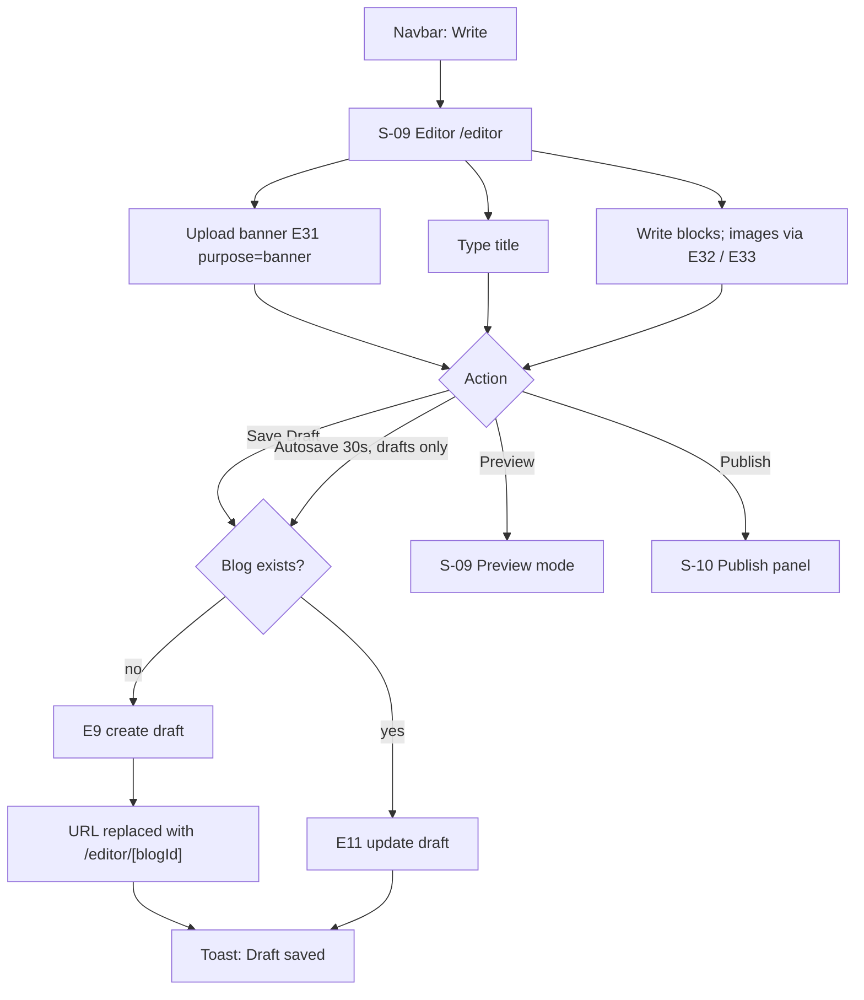
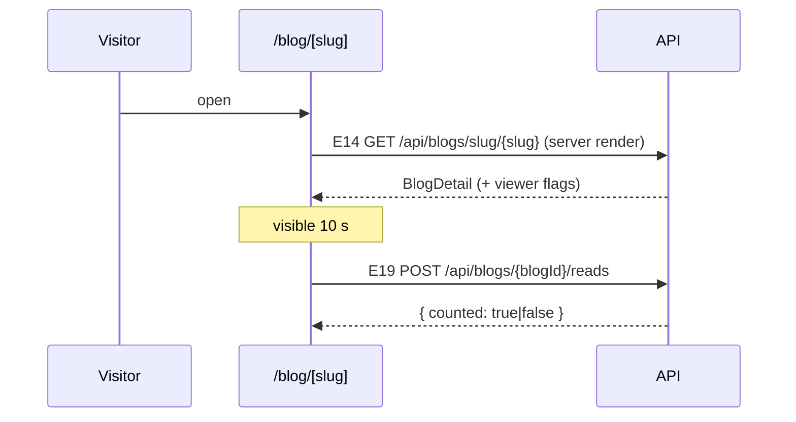
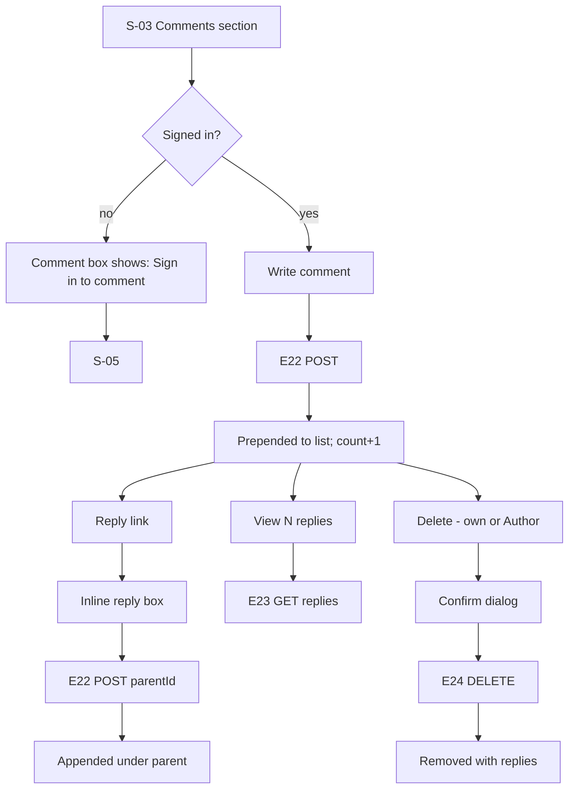

# Byline — User Flows

| | |
|---|---|
| Version | 1.0 |
| Based on | [PRD](01-PRD.md) · [SRS](02-SRS.md) |
| Screens | Named exactly as in [UI & UX Spec](04-UI-UX-SPEC.md) (`S-xx`) |
| Endpoints | Named exactly as in [API Spec](08-API-SPEC.md) (`Exx`) |

Notation: **[Screen]** · `Action` · *(Endpoint)* · ⟶ result.

---

## 0. Sitemap

---

## 1. Authentication (F-01)

### 1.1 Sign up
1. Guest clicks **Sign in** in the navbar → **[S-05 Sign in]** → link "Create an account" → **[S-06 Sign up]**.
2. Enters name, email, password → `Create account` *(Better Auth sign-up)*.
3. Server creates `user` + `account`, generates username (FR-AUTH-02), creates session.
4. ⟶ Redirect to `callbackUrl` or `/`. Toast "Welcome to Byline".

Errors: email already used → inline "An account with this email already exists." · password < 8 → inline.

### 1.2 Sign in

### 1.3 Forgot / reset password
1. **[S-05]** → "Forgot password?" → **[S-07]** → enter email → `Send reset link`.
2. ⟶ Always shows "If an account exists, we sent a link" (no enumeration).
3. Email link → **[S-08 Reset password]** `/reset-password?token=…` → new password ×2 → `Reset password`.
4. ⟶ All sessions revoked → redirect **[S-05]** with toast "Password updated. Please sign in."
5. Expired/used token → **[S-08]** shows "This link has expired" + button "Send a new link" → **[S-07]**.

### 1.4 Route guards
- Guest opens a Member route → redirect `/sign-in?callbackUrl=<route>`.
- Member opens a Guest-only route → redirect `/`.

---

## 2. Write, draft, preview, publish (F-03, F-04)

### 2.1 New blog → draft

### 2.2 Publish panel
1. **[S-09 Editor]** → `Publish` → **[S-10 Publish panel]** (full-screen overlay).
2. Left: preview card (banner, title, description). Right: description textarea (counter /200), topics input with autocomplete *(E26 `?q=`)*; Enter or comma adds a topic chip (max 5).
3. `Publish` → client validates (FR-PUB-03) → *(E12)* with all fields.
4. ⟶ Success: redirect `/blog/[slug]`, toast "Published". Subscribers receive `NEW_BLOG`.
5. ⟶ 422: panel stays open, inline errors per field (banner/title errors also scroll the editor behind into view when panel is closed).
6. `Close` (×) → back to **[S-09]** without changes.

### 2.3 Preview
**[S-09]** → `Preview` → the editor body is replaced by the reader layout (banner, title, author row, rendered blocks; interaction bar disabled). Bar shows `Back to editing`.

### 2.4 Edit a published blog
1. **[S-11 Manage blogs]** or **[S-03 Reader]** (Author sees `Edit` in the author row) → **[S-09]** `/editor/[blogId]` *(E10)*.
2. Bar shows `Preview` + `Update` (FR-EDIT-09).
3. `Update` → **[S-10]** (button reads **Update**) → *(E12)* ⟶ `/blog/[slug]`, toast "Updated".

### 2.5 Leave with unsaved changes
Any navigation away from **[S-09]** while dirty → dialog "Discard unsaved changes?" `Keep editing` / `Discard`.

---

## 3. Discover & read (F-05, F-09, F-10)

### 3.1 Home feed
1. **[S-01 Home]** loads *(E8 `sort=latest`)*.
2. `Trending` tab → *(E8 `sort=trending`)*. Topic chip → URL `/?topic=<slug>` → *(E8 `topic=`)*.
3. Scroll → next page via `nextCursor` (infinite scroll).
4. Click card → **[S-03]**.

### 3.2 Search
1. Navbar search → type `q` → Enter → **[S-02 Search]** `/search?q=…&tab=blogs` *(E25 `type=blogs`)*.
2. `Users` tab → *(E25 `type=users`)*. Topic chip on a result → `/search?q=…&topic=<slug>`.
3. Empty → "No results for "q"" + popular topics *(E26)*.

### 3.3 Read

---

## 4. Interact (F-06, F-07, F-08, F-11)

### 4.1 Like
- Member taps ♡ → optimistic fill + count+1 → *(E17 PUT)*; tap again → *(E18 DELETE)*. On error → revert + toast.
- Guest taps ♡ → `/sign-in?callbackUrl=/blog/[slug]`.
- Author: ♡ disabled with tooltip "You can't like your own blog".

### 4.2 Comment & reply

### 4.3 Share
`Share` → menu: Copy link · X · Facebook · LinkedIn · WhatsApp · Email → opens share URL in new window (Copy link → clipboard + toast "Link copied") → *(E20 `{ channel }`)* fire-and-forget.

### 4.4 Subscribe
**[S-04 Profile]** or reader author row → `Subscribe` → *(E6)* → button becomes `Subscribed` (hover: `Unsubscribe`) → *(E7)*. Guest → sign in.

---

## 5. Notifications (F-12)

1. Navbar bell polls *(E28)* every 30 s + on focus; dot shows when count > 0.
2. Click bell → **[S-13 Notifications]** *(E27 `type=all`)*.
3. Filter chips: All · Like · Comment · Reply · Share · Subscription → *(E27 `type=…`)*.
4. Click an item → *(E29)* → navigate:
   | Type | Destination |
   |---|---|
   | `LIKE`, `SHARE`, `NEW_BLOG` | `/blog/[slug]` |
   | `COMMENT`, `REPLY` | `/blog/[slug]#comment-[commentId]` |
   | `SUBSCRIBE` | `/u/[actor.username]` |
5. Inline `Reply` on COMMENT/REPLY items opens a reply box → *(E22 with `parentId`)*.
6. `Mark all as read` → *(E30)*.

---

## 6. Dashboard (F-13)

1. Avatar menu → `Dashboard` → **[S-11 Manage blogs]** `?tab=published` *(E15 `status=PUBLISHED`)*.
2. `Drafts` tab → *(E15 `status=DRAFT`)*. Search box → *(E15 `q=`)* (debounced 300 ms).
3. Row actions:
   - `Edit` → **[S-09]** `/editor/[blogId]`.
   - `Stats` → **[S-12]** *(E16)*.
   - `Delete` → dialog "Delete "{title}"? This can't be undone." → *(E13)* → row removed, toast "Blog deleted".

---

## 7. Profile & settings (F-02, F-14)

### 7.1 Edit profile
1. **[S-14 Edit profile]** loads *(E1)*.
2. `Upload` avatar → file picker → crop dialog (1:1) → *(E31 purpose=avatar)* → preview updates.
3. Username field → debounced *(E3)* → ✓ "Available" / ✕ "Taken".
4. Bio counter "N characters left" (200).
5. `Update` → *(E2)* → toast "Profile updated".

### 7.2 Change password
**[S-15]** current + new password → `Change password` *(Better Auth change-password, `revokeOtherSessions: true`)* → toast "Password changed". Wrong current → inline "Current password is incorrect". Google-only account → notice + link to **[S-07]** (FR-PROF-05).

### 7.3 Sign out
Avatar menu → `Sign out` *(Better Auth sign-out)* → `/`.
