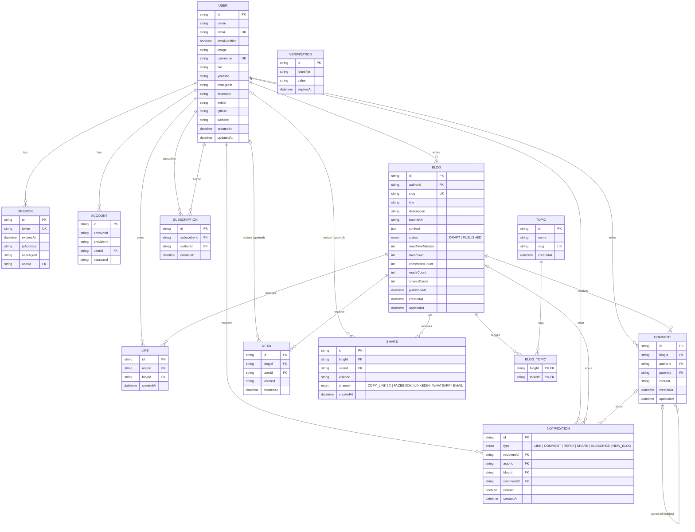

# Byline — Entity Relationship Diagram

| | |
|---|---|
| Version | 1.0 |
| Source of truth | [Database Schema](06-DATABASE-SCHEMA.md) — this diagram mirrors it 1:1 |

---

## 1. Diagram

`VERIFICATION` has no relations (Better Auth tokens for password reset).

## 2. Relationships & cardinality

| # | Relationship | Cardinality | FK | On delete |
|---|---|---|---|---|
| R1 | User → Session | 1 : N | `session.userId` | Cascade |
| R2 | User → Account | 1 : N (credential, google) | `account.userId` | Cascade |
| R3 | User → Blog (author) | 1 : N | `blog.authorId` | Cascade |
| R4 | Blog ↔ Topic via BlogTopic | M : N (publish: 1–5 per blog) | `blog_topic.blogId`, `blog_topic.topicId` | Cascade |
| R5 | User → Like ← Blog | 1 : N each; unique `(userId, blogId)` | `like.userId`, `like.blogId` | Cascade |
| R6 | User → Comment ← Blog | 1 : N each | `comment.authorId`, `comment.blogId` | Cascade |
| R7 | Comment → Comment (replies) | 1 : N, one level deep | `comment.parentId` | Cascade |
| R8 | Blog → Read; User → Read (optional) | 1 : N; 0..1 : N | `read.blogId`, `read.userId` | Cascade; SetNull |
| R9 | Blog → Share; User → Share (optional) | 1 : N; 0..1 : N | `share.blogId`, `share.userId` | Cascade; SetNull |
| R10 | User (subscriber) → Subscription ← User (author) | M : N self-relation; unique `(subscriberId, authorId)` | `subscription.subscriberId`, `subscription.authorId` | Cascade |
| R11 | User → Notification (recipient, actor) | 1 : N each | `notification.recipientId`, `notification.actorId` | Cascade |
| R12 | Blog → Notification | 0..1 : N | `notification.blogId` | Cascade |
| R13 | Comment → Notification | 0..1 : N | `notification.commentId` | Cascade |

## 3. Notification field usage

| `type` | `actorId` | `recipientId` | `blogId` | `commentId` |
|---|---|---|---|---|
| `LIKE` | liker | blog author | ✓ | — |
| `COMMENT` | commenter | blog author | ✓ | new comment |
| `REPLY` | replier | parent comment author | ✓ | new reply (parent via `comment.parentId`) |
| `SHARE` | sharer (signed in) | blog author | ✓ | — |
| `SUBSCRIBE` | subscriber | author | — | — |
| `NEW_BLOG` | author | each subscriber | ✓ | — |
